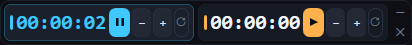

# Dual Stopwatch / Двойной секундомер

Компактный двойной секундомер для Windows 10/11. Приложение располагается поверх
других окон, поддерживает горячие клавиши, перемотку времени, автопаузу при
неактивности и сохранение состояния.



## Возможности

- Два табло в одной компактной панели.
- Одновременно работает только одно табло: запуск второго ставит первое на паузу.
- Перемотка на 10 минут назад и вперёд без ухода времени ниже нуля.
- Автопауза после выбранного периода отсутствия ввода мыши и клавиатуры.
- После автопаузы таймер остаётся остановленным до ручного запуска.
- Настраиваемый период неактивности: 1, 2, 3, 5 или 10 минут.
- Сохранение времени обоих табло и настроек между запусками.
- Режим «всегда поверх окон» и прилипание к границам экранов.
- Поддержка Per-Monitor DPI для конфигураций с несколькими мониторами.
- Установка не требуется.

## Скачать

Готовый [`DualStopwatch.exe`](https://github.com/wowa683/dual-stopwatch/releases/latest/download/DualStopwatch.exe)
доступен в разделе **Releases** репозитория.

Приложение рассчитано на Windows 10/11 с .NET Framework 4.8.

## Управление

| Элемент или клавиша | Действие |
| --- | --- |
| `1` / `2` | Выбрать табло без запуска или остановки |
| `ПРОБЕЛ` | Запустить или поставить на паузу выбранное табло |
| `←` / `→` | Перемотать выбранное табло на 10 минут назад или вперёд |
| `R` | Сбросить выбранное табло |
| `−` / `+` | Перемотать соответствующее табло на 10 минут |
| ▶ / ❚❚ | Запустить или поставить соответствующее табло на паузу |
| ↻ | Сбросить соответствующее табло |
| ⚙ | Открыть настройки автопаузы |
| ✕ | Закрыть приложение |

Выбранное табло выделяется цветной рамкой. Выбрать его также можно щелчком мыши.

## Автопауза и сохранение

При отсутствии ввода мыши и клавиатуры дольше заданного времени работающее табло
останавливается. Оно не запускается автоматически после возвращения пользователя.

Данные сохраняются в `%LOCALAPPDATA%\Stopwatch2`:

- `stopwatch_state.txt` — время обоих табло;
- `stopwatch_idle_settings.txt` — период неактивности.

## Размещение окна

При запуске приложение пытается разместиться в левом нижнем углу монитора
`\\.\DISPLAY4`. Если такого монитора нет, используется четвёртый найденный монитор
или последний доступный. Окно можно перетащить; после отпускания оно прилипает к
ближайшей границе экрана или рабочей области.

## Сборка из исходников

Проект написан на C# и WPF без XAML и внешних NuGet-пакетов. Visual Studio и .NET SDK
не требуются: скрипт использует штатный компилятор .NET Framework 4.8.

```powershell
powershell -NoProfile -ExecutionPolicy Bypass -File .\scripts\build.ps1
```

Результат сборки: `Секундомер.exe` в корне проекта.

Структура проекта:

- `src/Stopwatch2.cs` — исходный код приложения;
- `src/app.manifest` — манифест Windows и настройка DPI;
- `scripts/build.ps1` — сборка приложения;
- `scripts/make-icon.ps1` — создание иконки при её отсутствии.

## Лицензия

Проект распространяется по лицензии [MIT](LICENSE).
